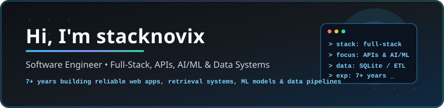

  

 

  

  
  
  
  

---

### 👋 About Me

Software engineer with **7+ years of professional experience** designing and shipping **full-stack web applications**, **high-reliability APIs**, **applied AI/ML workflows**, and **data engineering pipelines**.

> 🔒 My current portfolio contains independent, runnable demonstrations built with synthetic data. Project source repositories are kept private.

---

### 🚀 Selected Portfolio Projects

| Project | Stack | What It Demonstrates |
| :--- | :--- | :--- |
| 🛡️ **Risk Review Console** | `React` `Express` `Node.js` | Claim CRUD (`POST/GET/PATCH/DELETE`), searchable paginated queues, supervisor resolutions, optimistic version checks, and actor audit trails. |
| ⚙️ **Agent Workflow Service** | `Node.js` `Express` | Durable local jobs, atomic batch submission, idempotency keys, cancellation, deletion, operational metrics, and deterministic routing evaluation. |
| 🧠 **Knowledge Assistant** | `FastAPI` `Python` `SQLite` | Document chunking, permission-filtered BM25 retrieval, source citations, reusable role-isolated indexes, and live SQLite CRUD. |
| 📊 **Fraud Risk Model** | `Scikit-learn` `FastAPI` | Model training, separate holdout evaluation, threshold & drift diagnostics, validated exports, score explanations, and batch inference. |
| 🌊 **Retail Data Pipeline** | `Python` `SQLite` `FastAPI` | Streaming ingestion, quality gates, quarantine, deduplication, data lineage, transactional rollback, and observability endpoints. |
| 📦 **Project Catalog API** | `FastAPI` `Pydantic` `SQLite` | Shared authenticated CRUD service with status/stack filtering, slug lookup, pagination, seeding, and stale-write protection. |

---

### 🛠️ Tech Stack

  
  
  
  
  
  
  
  
  
  

---

### 📌 Note on Demonstrations
All portfolio projects are local, self-contained software demonstrations using synthetic or fixture data. Metrics describe generated datasets only and do not imply employer affiliation or production deployment.
